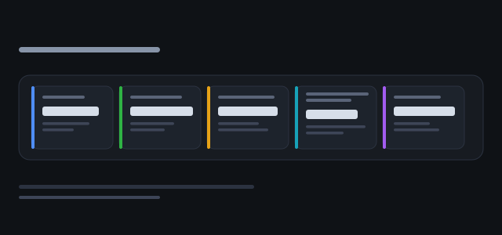
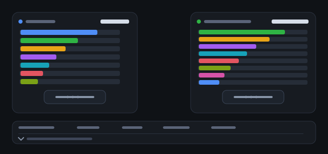

# Provod spending

The panel shows workspace spending and the account balance. Every API request is made by the Host on your machine: keys never reach the browser.

## Top row

- **Today** and **Month to date** — actual spending and request counts.
- **Month-end forecast** — the month-to-date pace. Hidden during the first two days: one large charge would make the projection unrealistic.
- **Needed to month end (forecast)** — the forecast minus what has already been spent. A negative value means the actual spending is already above the forecast.
- **Account balance** — the exact available balance after reservations when DSH holds a regular `PROVOD_API_KEY`; otherwise a credits-minus-usage estimate marked “≈”, which excludes reservations and refunds.

## Spending by model

- Two lists — today and month to date. Each shows the 10 models with the highest spending; **Show all · N** expands the list and **Show less** collapses it. The lists expand independently.
- The table below repeats both periods, the month share and request counts; it also shows the top 10.
- **Spending by day** — one bar per day of the month, the last one being today.

## Model efficiency

Month to date: tokens per request, price per million, input cache, error share, mean response time and output speed. Time-adjusted cost rescales the price of a million tokens to a 60-second reference: a model twice as slow as the reference rises only if it is much cheaper. Models with few requests, a high error share or no spending are not ranked — they are listed in the **Not ranked · N** disclosure.

## Keys and data

- A workspace management key is required for spending reports; paste it into the “Key” section on the page — the value is kept in the DSH credential store.
- A regular `PROVOD_API_KEY` is needed only for the exact balance.
- A refresh makes up to five requests to `api.provod.ai`: balance or credits, two model queries and hourly rows. Only the keys and date ranges are sent.
- Provod limits analytics to 2 requests per second and 30 per minute; the panel paces its queries.
