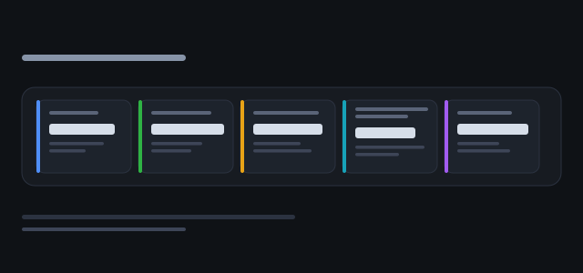
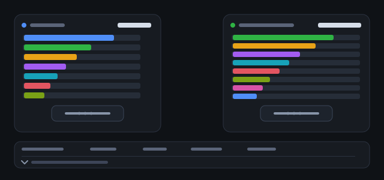

# Расходы Provod

Панель показывает расходы рабочего пространства Provod и остаток на счёте. Все запросы к API делает Host на вашей машине: ключи в браузер не попадают.

## Верхний ряд

- **Сегодня** и **С начала месяца** — фактические расходы и число запросов.
- **Прогноз до конца месяца** — темп с начала месяца. В первые двое суток не показывается: одна крупная трата дала бы нереалистичный прогноз.
- **Потребность до конца месяца (прогноз)** — прогноз минус уже потраченное. Отрицательное значение означает, что факт уже выше прогноза.
- **Остаток на счёте** — точный остаток после резервов, если в DSH есть обычный ключ `PROVOD_API_KEY`; иначе оценка «пополнения минус расходы» с пометкой «≈», которая не учитывает резервы и возвраты.

## Расходы по моделям

- Два списка — за сегодня и с начала месяца. Показываются 10 моделей с наибольшими расходами; кнопка **«Показать все · N»** раскрывает весь список, **«Свернуть»** возвращает ТОП-10. Списки раскрываются независимо друг от друга.
- Таблица ниже повторяет суммы за оба периода, долю месяца и число запросов; в ней тоже ТОП-10.
- **Расходы по дням** — столбик на каждые сутки месяца, последний — сегодня.

## Эффективность моделей

За месяц: токены на запрос, цена миллиона, кеш входа, доля ошибок, среднее время ответа и скорость вывода. «Цена с поправкой» пересчитывает цену миллиона токенов на эталонные 60 секунд обработки: модель вдвое медленнее эталона поднимается выше только если она значительно дешевле. Модели с малым числом запросов, высокой долей ошибок или без расходов не ранжируются — они перечислены в спойлере **«Не ранжированы · N»**.

## Ключи и данные

- Управляющий ключ рабочего пространства нужен для отчёта о расходах; вставьте его в разделе «Ключ» на самой странице — значение хранится в хранилище учётных данных DSH.
- Обычный `PROVOD_API_KEY` нужен только для точного баланса.
- Обновление делает до пяти запросов к `api.provod.ai`: баланс или пополнения, две выборки по моделям и почасовые строки. Передаются только ключи и диапазоны дат.
- Лимит аналитики — 2 запроса в секунду и 30 в минуту; панель выдерживает паузы между запросами.
